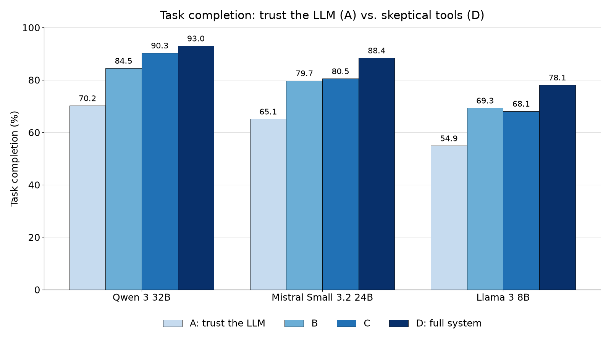
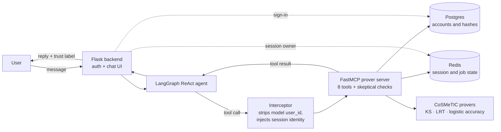

# Natural-Language Zero-Knowledge Verification via Skeptical MCP Tools

[](https://github.com/disys-lab/Skeptical-MCP-For-zkSNARKs/actions/workflows/reproduce.yml)


**An LLM agent that lets non-experts run and verify zero-knowledge proofs in plain English, plus an ablation study showing that tools which check, complete or override what the model sends raise task completion by about 23 points across three model families.**

[Paper](manuscript/) · [Reproduce every number offline](#reproducing-the-papers-numbers-offline) · [Architecture deep-dive](ARCHITECTURE.md)

## The idea in one minute

An LLM is good at understanding what a user wants. It is not reliable at supplying exact values such as job IDs, proof types and user identities. In a zero-knowledge system those values decide *which* statistical test is proven and *whose* data the proof is bound to, so a small slip can produce a valid proof of the wrong thing.

**Skeptical tools** do not trust what the model sends. Each MCP tool checks the model's arguments against server-side state before it runs, using three moves:

| Move | What the tool does | Example in this repo |
|---|---|---|
| **Validate** | Reject a bad value with a clear error | `verify_proof` returns "proof type is required" instead of guessing a prover (Configs A and B; in C and D it first uses the stored type and probes the provers, then falls back to logistic accuracy) |
| **Complete** | Fill a missing value from stored state | `check_status` takes the proof type from the stored job when the model leaves it out |
| **Override** | Replace the model's value with the server's | The interceptor strips any model-supplied `user_id` and injects the real session identity |

The system has 20 such design decisions in four groups: input skepticism, state independence, output integrity and security boundaries. Five of them are switched on and off in the ablation below.

## Results at a glance

Task completion on the 75-query suite (mean of 5 runs at temperature 0; 375 records per model per configuration; 6,000+ query executions and 6,371 records in total):

| Model | A: trust the LLM | B | C | D: full system | Gain (A→D) |
|---|---|---|---|---|---|
| Qwen 3 32B | 70.2% | 84.5% | 90.3% | **93.0%** | +22.8 |
| Mistral Small 3.2 24B* | 65.1% | 79.7% | 80.5% | **88.4%** | +23.3 |
| Llama 3 8B | 54.9% | 69.3% | 68.1% | **78.1%** | +23.2 |

<p align="center">
  
</p>

\* Mistral's reference job never reached `done` in Configs B, C, D and A*, so its status and download cells are not comparable with the other models. Within-model gains are unaffected. See [Deviations and known issues](#deviations-and-known-issues).

## What we found

- **A plausible default is worse than no default.** With the stored proof type turned off, `check_status` silently defaulted to one prover and sent **198** status checks to the wrong one. Storing the proof type server-side cut this to **0** for all three models. `verify_proof`, which has no default, never misrouted (0 of 24 calls in Config B).
- **Never take identity from the model.** Without server-side identity injection, models filled the slot with placeholders such as `"user123"`. Login-required tasks rose from **47.5% to 93.0%** (Qwen 3 32B) once the server injected the real identity.
- **Made-up results need chat history plus a past success.** All 7 fabricated results across the 24 result files happened in the one setup that replayed chat history containing an earlier success. Stateless tool turns produced none.
- **Grade every tool call, not only the first.** In Config B, the original grader would have ranked the strongest model (Qwen 3 32B, 83.8%) as the least reliable. The corrected grader reads every tool call in the turn and agrees with hand labels on **150 of 151** flagged replies.
- **Fewer calls, faster replies.** From Config B to C, tool calls per status check fell from 1.44 to 1.00 and average response time from 16.6 s to 12.4 s.
- **End to end.** Qwen 3 32B completed the full prove → status → download → verify lifecycle in every run of Configs C and D.

The paper also states the limits plainly: an invented job ID still defeats the fallbacks, the nonce is fixed, and hashes and job IDs reach the model provider. See [Deviations and known issues](#deviations-and-known-issues).

## Architecture



## Five rules for MCP tool design (from the paper)

1. **Override routing values from authoritative state.** If the server already knows the right backend, ignore the model's value, but check that the key it uses (such as a job ID) belongs to the session.
2. **Strip and inject identity on the server.** A model-supplied identity is only the model's word.
3. **Keep chat history out of tool-grounded turns.** History with a past success was the only condition under which any model made up a result.
4. **Make trust labels vouch for outcomes, not calls.** A failed tool call should never earn a "backed" label.
5. **Scrub tool outputs before the model sees them,** and test the boundary on every model you deploy, because fallback behavior varies a lot between models.

In industry terms, skeptical tools are pre-tool-call guardrails with validate and mutate hooks, placed where MCP gateways put their checks, with the effect measured across three model families.

## System overview

Code and data for the paper *Natural-Language Zero-Knowledge Verification via Skeptical MCP Tools* (see [Paper and artifact map](#paper-and-artifact-map)).

The system, the **MCP Prover Chatbot**, is a dockerized chat assistant that lets authenticated users interact with the **CoSMeTIC** zero-knowledge proof service through natural language. Queries flow through a LangGraph ReAct agent (default model **Qwen3-32B** through an OpenAI-compatible API, swappable via `LLM_MODEL` and `LLM_BASE_URL`; cross-model runs have also used Llama 3 8B and Mistral-Small 24B) which calls MCP tools exposed by a dedicated prover server. Session state lives in Redis; user accounts in Postgres.

The repository also hosts an **ablation study** — four main configurations (A/B/C/D) plus a supplementary `A_STAR` variant — comparing architectural design choices (identity protection, server-side state, smart Redis fallbacks, LLM summarization). See `ARCHITECTURE.md` for the complete design.

## Contents

- **Want the results?** → [Results at a glance](#results-at-a-glance) · [What we found](#what-we-found) · [Five rules](#five-rules-for-mcp-tool-design-from-the-paper)
- **Just want to run it?** → [Quick start](#quick-start) · [Example queries](#example-queries). That's all you need — stop after step 4.
- **Reproducing the research / ablation study?** → [Ablation configs](#ablation-study--configurations) · [Test suite](#running-the-ablation-test-suite) · [Grading](#grading-results) · [Sweeps](#multi-model--multi-config-sweeps)
- **Here for the paper's artifacts?** → [Paper and artifact map](#paper-and-artifact-map) · [Reproduce the numbers offline](#reproducing-the-papers-numbers-offline) · [Models and providers](#models-and-providers) · [Deviations and known issues](#deviations-and-known-issues)
- **Reference:** [Endpoints](#key-endpoints) · [Schema](#schema) · [Security](#security-notes) · [Config vars](#configuration-reference) · [Unit tests](#tests) · [Repo layout](#repository-layout) · [Architecture deep-dive (`ARCHITECTURE.md`)](#further-reading)

## Paper and artifact map

This repository is the artifact for *Natural-Language Zero-Knowledge Verification via Skeptical
MCP Tools* (Shanto and Ramanan, Oklahoma State University, 2026). Citation metadata is in
`CITATION.cff`. The manuscript is in `manuscript/`. The code exactly as released with the paper is
tagged [`paper-v1`](https://github.com/disys-lab/Skeptical-MCP-For-zkSNARKs/tree/paper-v1). Code is MIT-licensed (`LICENSE`); the evaluation data is CC BY 4.0 (`LICENSE-DATA`).

| The paper promises | Where it is |
|---|---|
| Test suite: 75 main queries plus 7 verification queries | `eval/test_suite.json`, `eval/test_suite_verify.json`; composition in `eval/MANIFEST.md` |
| Original faithfulness grader, as run | `eval/grading_script.py` |
| Corrected faithfulness grader | `eval/grading_faithfulness_v2.py`; controls and hand-label check in `eval/test_grading_faithfulness_v2.py` |
| Experiment results: 24 files, 6,371 records | `results/`; one row per file in `results/RESULTS_MANIFEST.csv` |
| Hand-read inspection dumps (Sections V-B, V-E) | `reports/inspection_*.txt`; the 252 wrong-port replies classified in `reports/wrongport_replies_classified.txt` |
| Every number in the paper, recomputed offline | `eval/reproduce_paper_numbers.py`; its saved output `eval/expected_output.txt` |

**How to cite.** GitHub's *Cite this repository* button reads `CITATION.cff`. Until the paper has a public identifier:

```bibtex
@misc{shanto2026nlzk,
  title  = {Natural-Language Zero-Knowledge Verification via Skeptical MCP Tools},
  author = {Shanto, Md Nazrul Huda and Ramanan, Paritosh},
  year   = {2026},
  note   = {Oklahoma State University. Artifact: https://github.com/disys-lab/Skeptical-MCP-For-zkSNARKs}
}
```

## Architecture at a glance

| Service | Container | Port | Role |
|---|---|---|---|
| Backend | `mcp-backend` | 5001 | Flask UI + auth + LangGraph agent + MCP client |
| Prover MCP | `mcp-prover-server` | 8003 | FastMCP server exposing proof tools; owns all job/session state |
| Redis | `mcp-redis` | 6379 | Session state, job records, optional chat history (7-day TTL) |
| Postgres | `mcp-postgres` | 5432 | Dataset-driven user accounts with bcrypt passwords |

**Design rule:** Flask stays thin (HTTP, auth, one security-critical Redis write for session ownership). The MCP prover owns all proof-lifecycle state and all COSMeTIC API calls.

**External dependency:** this chatbot is the front end to the separate **COSMeTIC** prover stack — it cannot run without it. COSMeTIC provides the prover APIs on ports `5012` (logistic_accuracy), `5013` (KS), `5014` (LRT) and the input-files service on `5015`, and its Docker Compose project creates the `regulatory_hypothesis_tests_default` network that this stack joins. Start COSMeTIC **before** this stack — see the Prerequisites below.

## Quick start

### Prerequisites

- Docker and Docker Compose
- An API key for an OpenAI-compatible LLM endpoint. The paper's runs used DeepInfra (https://deepinfra.com); any compatible provider works through `LLM_BASE_URL`.
- **The COSMeTIC prover stack running** (see Step 0) — without it this chatbot has no provers to talk to and no users to sign in as.

### 0. Start COSMeTIC (required first)

This chatbot is only the front end — it depends on the separate **COSMeTIC** prover stack, which must be set up and running **before** this one:

> **https://github.com/disys-lab/cosmetic/tree/formcp-integration** (branch `formcp-integration` of the official COSMeTIC repository); project page https://disys-lab.github.io/cosmetic/
>
> The paper's experiments ran against the earlier repository https://github.com/disys-lab/regulatory_hypothesis_tests, branch `forMCP`. The `formcp-integration` branch carries the same API code on top of the official repository.

**Follow COSMeTIC's own README to set it up and run it** — that is the authoritative source. Its setup is a real pipeline (SMT setup + EZKL zkSNARK generation via `driver.py`, plus a one-time per-API "Setup" step); do not expect a single `up` command to be enough. We deliberately don't reproduce those steps here because they live in (and will change with) that repo.

What this stack additionally needs from COSMeTIC once it's running:

- **Run it with the project name `regulatory_hypothesis_tests`** so its default network is named `regulatory_hypothesis_tests_default` — the network this stack joins as `external`:
  ```bash
  git clone -b formcp-integration https://github.com/disys-lab/cosmetic
  cd cosmetic
  # ... set up / generate proof data per COSMeTIC's README, then:
  docker compose -p regulatory_hypothesis_tests up -d
  ```
  (If you start it under a different project name, update the `networks:` block in this repo's `docker-compose.yml` to match the actual network name from `docker network ls`.)
- **The provers must expose ports `5012` (ACC), `5013` (KS), `5014` (LRT), and input-files on `5015`.**
- **There must be proof data.** COSMeTIC's `proofs/` is gitignored, so a fresh clone has none until you run its proving pipeline. Without data, `/admin/sync-dataset` (Step 3) returns zero users and you can't sign in.
- **Verify it's ready** before continuing: `curl -s http://localhost:5015/input-files/list` should return a non-empty JSON list of input files.

### 1. Create `.env`

```bash
cp .env.example .env     # then put your API key in DEEPINFRA_API_KEY
```

The template sets:

```bash
DEEPINFRA_API_KEY=your_key_here
LLM_BASE_URL=https://api.deepinfra.com/v1/openai
LLM_MODEL=Qwen/Qwen3-32B
CONFIG=C
EVAL_MODE=true
SECRET_KEY=change-me-in-production
```

`CONFIG` selects the ablation configuration (`A` / `B` / `C` / `D`, plus the supplementary `A_STAR`). `C` is the current/default full system. `EVAL_MODE=true` adds a `tool_calls` log to every `/get` response — useful for the test runner and for debugging. `LLM_MODEL` selects the model and `LLM_BASE_URL` the endpoint (default `Qwen/Qwen3-32B` on DeepInfra); it has also been run with `meta-llama/Meta-Llama-3-8B-Instruct` and `mistralai/Mistral-Small-3.2-24B-Instruct-2506`.

### 2. Build and start

```bash
docker-compose build
docker-compose up -d
```

Verify both services came up with the right config:

```bash
docker-compose logs backend 2>&1 | grep "System configuration" | tail -1
docker-compose logs proverserver 2>&1 | grep "Prover server configuration" | tail -1
```

The backend prints `System configuration: C` and the prover prints `Prover server configuration: C` (or whichever `CONFIG` you set) — both must match.

### 3. Wait for readiness and sync the dataset

Wait for the agent to initialize (probe `/get` directly — log line is unreliable under Flask debug mode's buffering):

```bash
until curl -s -X POST http://localhost:5001/get \
    -H "Content-Type: application/json" \
    -d '{"msg":"ping","session_id":"probe"}' 2>/dev/null | grep -q '"response"'; do
  sleep 3
done
```

Then sync dataset users into Postgres:

```bash
curl -X POST http://localhost:5001/admin/sync-dataset
```

This fetches the input-files zip from COSMeTIC and upserts `dataset_users` rows named `User1`, `User2`, ..., each with one `raw_hash` and one `input_data` JSON blob. The shared password is `password123` (or whatever `DATASET_DEFAULT_PASSWORD` is set to).

### 4. Open the UI

`http://localhost:5001` — sign in as `User1` / `password123` and chat.

> **Running on a remote server?** `localhost:5001` / `127.0.0.1:5001` only work when the stack runs on the same machine as your browser — from a remote machine they show `ERR_CONNECTION_REFUSED`. Instead, either browse the **server's IP directly** (`http://<server-ip>:5001`, if your network/firewall allows it), or **forward the port** to your machine — the VS Code **Ports** panel (forward `5001`), or `ssh -L 5001:localhost:5001 <user>@<server>`. Note: the app binds `0.0.0.0` with Flask `debug=True`, so don't expose port `5001` to the public internet.

## Example queries

```
Prove my data in KS
Check my status
Check where my data has been used
Download the proof
Verify my proof                   # confirm the proof is cryptographically valid
Prove hash abc123 in LRT          # explicit hash (not "my hash")
```

> **That's it for running the chatbot.** Everything below is for the **ablation study and evaluation** — skip it unless you're reproducing the research.

## Ablation study — configurations

| Config | Philosophy | Identity protection | Conversation history | Redis fallbacks (B4/B5/B6) | LLM summarizes response |
|---|---|:---:|:---:|:---:|:---:|
| **A** | "Trust the LLM" | off | on (replay history) | off | on |
| **B** | "Distrust LLM memory" | on | off | partial (B4 only; B5/B6 off) | on |
| **C** | Full system (default) | on | off | all on | on |
| **D** | No LLM summary layer | on | off | all on | **off** (deterministic formatter) |
| **A_STAR** | "Identity in the prompt" (supplementary) | off (`user_id` named in a system prompt instead of injected) | on (replay history) | B4 on; B5/B6 off | on |

To switch configs, edit `.env` and restart:

```bash
sed -i 's/^CONFIG=.*/CONFIG=D/' .env
docker-compose down && docker-compose up -d
```

See `ARCHITECTURE.md` §12 for the full gate-by-gate code references.

## Running the ablation test suite

The test runner (`test_runner.py`) executes `test_suite.json` (75 executable queries across 7 source types; the file also holds 5 standalone Source-3a entries that are skipped at runtime) against the running backend for a given CONFIG and writes results to `results/results_{CONFIG}.json` (the `results/` directory is created automatically; override with `--results-dir`). Runs are resumable. The runner refuses to start unless `LLM_MODEL` is set, and stops if the reference proof job does not reach `done` within about 17 minutes (see [Deviations and known issues](#deviations-and-known-issues)). Pass `--test-suite eval/test_suite_verify.json` to run the 7-query `verify_proof` evaluation suite instead (results still land in `results/results_{CONFIG}.json`).

```bash
# Pilot: one run through the 75 queries (run from the repo root)
PYTHONUNBUFFERED=1 python -u eval/test_runner.py --config C --runs 1 --fresh

# Full: five runs (starts fresh; takes several hours)
python eval/test_runner.py --config C --runs 5 --fresh

# Continue an interrupted run (omit --fresh)
python eval/test_runner.py --config C --runs 5

# Re-execute any records that previously errored
python eval/test_runner.py --config C --runs 1 --retry-failed
```

Install the runner's requirements with `pip install -r requirements.txt`. In Docker-only setups, run it from the host with the ports exposed. The runner logs into `User1`, auto-creates a reference completed job at startup (skipped for Config A, where the identity gate is disabled), and injects test fixtures directly into Redis / Postgres as needed per query.

## Grading results

**To reproduce the paper's tables, use [`eval/reproduce_paper_numbers.py`](#reproducing-the-papers-numbers-offline) instead;** it reads the released files as they are named.

`grading_script.py` is the original grader. It reads `results_{A,B,C,D}.json` from `--results-dir` (default `results/`), which is the name the test runner writes, + `test_suite.json`, and prints the metric tables (tool selection, parameter correctness pre/post, task completion, response faithfulness, tool-use rate) as mean ± std across runs, with per-source and Config-A auth/non-auth breakdowns:

```bash
python eval/grading_script.py --configs A,B,C,D    # defaults: results/ dir, eval/test_suite.json
```

### What each metric means

| Metric | Question it answers | How it's scored |
|---|---|---|
| **Tool Selection** | Did the agent call the *right* tool? | First tool call vs `expected_tool` (or any of `acceptable_tools` for ambiguous Source-3b; for `expected_tool: NONE`, passes only if **no** tool was called). N/A on execution errors and qualitative cases. |
| **Param Correctness (pre)** | Were the tool arguments correct **as the LLM emitted them**, before any backend correction? | Each `expected_params` key must be present and match in the raw `arguments` (case-insensitive for `proof_type`). Measures the model's own accuracy. |
| **Param Correctness (post)** | Were the arguments correct **after** the interceptor fixed them? | Same check against `arguments_after_correction` (post `session_id` injection / `user_id` strip). Missing values are tolerated (they're injected, not model-supplied). Shows how much the backend recovers. |
| **Task Completion** | Did the user get the correct end-to-end outcome? | Response text must contain all `should_contain` (any-one for Source-2 error synonyms), must avoid `should_not_contain` (negation-aware — "no errors" doesn't trip "error"), satisfy `should_contain_any_redirect`, and honor `must_call_tool` / `expected_tool: NONE`. Counts as a failure on execution error. |
| **Response Faithfulness** | Does the user-facing reply match what the tool actually returned? | *Original grader; the paper reports the corrected grader in `grading_faithfulness_v2.py`, which reads every tool call in the turn and handles negation.* The tool's `job_id`/`status` must appear in the response (status accepts paraphrases of "done"); the LLM must **not** claim success when the tool returned an error. N/A when no tool was called. |
| **Tool-Use Rate (S7)** | On bait queries, did the agent call a tool instead of guessing? | Source-7 only (`must_call_tool`): passes if any tool was called (or `backed_by_cosmetic`). A high rate is good — it means the model resisted answering from nothing. |

Results are reported as **mean ± std across runs**. Source-6 multi-step scenarios use cascade scoring: if an early step fails, dependent later steps are marked *unreachable* rather than counted as separate failures (see `ARCHITECTURE.md` §13.4).

## Multi-model / multi-config sweeps

Shell orchestrators drive full sweeps end-to-end — they edit `.env`, recreate the backend + proverserver, run the suite, and archive results as `results/results_{model}_{config}.json`:

```bash
./eval/run_llama_all.sh     # Llama 3 8B  × A,B,C,D,A_STAR  -> results/results_llama_{config}.json
./eval/run_mistral_all.sh   # Mistral 24B × A,B,C,D,A_STAR  -> results/results_mistral_{config}.json
./eval/run_verify_all.sh    # verify_proof suite: Qwen A-D, Mistral C-D (its Llama C-D runs were not completed)
```

## Key endpoints

| Endpoint | Auth | Purpose |
|---|---|---|
| `GET /` | — | Chat UI |
| `POST /auth/signin` | — | Sign in as a dataset user |
| `POST /auth/logout` | — | Clear session |
| `GET /auth/me` | — | Current auth status |
| `GET /api/me/hash` | login required | Masked preview of the user's stored `raw_hash` |
| `POST /get` | — | Chat endpoint (session-scoped if logged in) |
| `POST /download_proof` | login required | Proxy a proof-file download |
| `GET /context/<session_id>` | login + owner | Inspect Redis session state |
| `POST /admin/sync-dataset` | optional secret | Re-run the dataset sync |

## Schema

Single init script at `sql/002_dataset_and_zips.sql`, applied automatically by the Postgres container:

- `dataset_users` — `id` (uuid PK), `username` (unique), `password_hash` (bcrypt), `raw_hash`, `input_data` (JSONB), `source_file`, `zip_archive_id` (FK), `created_at`, `updated_at`
- `input_zip_archives` — `id` (uuid PK), `source_url`, `stored_path`, `file_size_bytes`, `fetched_at`

Manual signup is **not supported** — accounts are created only by `/admin/sync-dataset`.

> The authoritative dataset is the COSMeTIC input-files zip ingested into Postgres by `/admin/sync-dataset`.

## Reproducing the paper's numbers offline

Every figure in the paper's tables and prose that derives from the logs can be recomputed from
`results/` alone, with no CoSMeTIC stack, no LLM and no network:

```bash
python eval/reproduce_paper_numbers.py                     # prints every derived figure with its definition
python eval/reproduce_paper_numbers.py > out.txt && diff --strip-trailing-cr out.txt eval/expected_output.txt
python eval/test_grading_faithfulness_v2.py                # four synthetic controls; hand-label agreement 150 of 151
```

On Linux and macOS, `diff` reports one line that differs only by the path separator
(`reports\wrongport_...` in the saved file, `reports/wrongport_...` in your output); every number matches.
See [Deviations and known issues](#deviations-and-known-issues).

`eval/expected_output.txt` is the output as saved at release. Figures marked **[H]** in the
output were established by hand-reading the dumps in `reports/` and are reported, not recomputed.
Only the standard library and the two graders in `eval/` are needed.

## Tests

`tests/` holds unit tests for the skeptical checks. They run on every push and pull request
(the `unit-tests` job in `.github/workflows/reproduce.yml`) and need no network, LLM, CoSMeTIC
or Docker: Redis is replaced by `fakeredis`, the prover APIs by a fake prover, and the
configuration is set per test.

| Check | What the tests confirm |
|---|---|
| A3 identity | The interceptor drops a model-supplied `user_id` and injects the session identity in Configs B, C and D; A and A* let the model's value through |
| D1 session lock | A session claimed by one user rejects another user, also through the `/get` endpoint; the lock fails closed when Redis is down |
| A1 proof types | Spellings such as `ks` and `kolmogorov-smirnov` map to the canonical names and to the right prover port |
| B4 job-ID fallback | A missing job ID falls back to the latest job in Configs B, C and D, but not in A |
| B5 stored proof type | `check_status` completes a missing proof type from the stored job (Configs C, D); Config B reproduces the wrong-port failure; `download_proof` and `verify_proof` override the model's value with the stored one; without a proof type, A and B return "proof_type is required" |
| B6 auto-detection | Download and verify probe all three provers, pick the one holding the job, prefer LRT then KS, and fall back to logistic accuracy when none has it |
| C5 and D4 downloads | Error text saved as a proof file is rejected; empty files are rejected; filenames cannot leave the downloads folder, on the MCP side or in the backend route |
| C1 and Config D | Trust labels follow the tool results; Config D templates report the tool output |

Two known issues are recorded as expected failures rather than hidden: `_normalize_proof_type`
does not accept "likelihood ratio test" with spaces, and on Windows the error-file check in
`download_proof` fails because the file is deleted while still open (it passes on Linux, where
the service runs). Note also that in Configs C and D, download and verify fall back to logistic
accuracy when no prover has the job, so "return an error rather than guessing" (paper, Sec. III-C)
holds for Configs A and B only.

```bash
pip install -r requirements.txt -r tests/requirements-test.txt
python -m pytest tests -q
```

## Models and providers

| Model | Identifier | Configurations | Provider |
|---|---|---|---|
| Qwen 3 32B (primary) | `Qwen/Qwen3-32B` | A, B, C, D, A*, verification A to D | Groq during development, DeepInfra for later runs; the provider of the main A to D study was not recorded per run |
| Mistral Small 3.2 24B | `mistralai/Mistral-Small-3.2-24B-Instruct-2506` | A, B, C, D, A*, verification C and D | DeepInfra |
| Llama 3 8B | `meta-llama/Meta-Llama-3-8B-Instruct` | A, B, C, D, A* | DeepInfra |
| Qwen 2.5 72B | not recorded | B only | not recorded |
| Qwen 3 235B-A22B | not recorded | B only, one run plus 11 queries | not recorded |

Result records written before September 2026 carry no model or provider field; the model per
file comes from the file name and the sweep scripts. See the provenance caveat under
[Repository layout](#repository-layout).

## Deviations and known issues

Stated plainly, because a reader of the code would otherwise infer the opposite.

- **Trust label tiers.** The evaluation ran a two-tier label (`[Backed by COSMeTIC prover]`,
  `[Not backed by COSMeTIC prover]`). The released `compute_trust_label` has four tiers; the two
  cryptographic tiers never appear in any logged turn and are unevaluated.
- **Post-run changes to the runner.** The `llm_model` and `llm_provider_base_url` record fields,
  the refusal to start without `LLM_MODEL`, and the hard failure when the reference job does not
  reach `done` were all added after the reported runs. The sweep scripts now pin `LLM_MODEL`;
  at run time they inherited whatever `.env` held.
- **Reference-job fixture.** In the Mistral, Qwen 2.5 72B and Qwen 3 235B sweeps the reference
  job stayed `queued` throughout (the poll timed out and the runner continued on a warning).
  Status- and download-dependent cells for those sweeps are not comparable with Qwen 3 32B or
  Llama; within-model comparisons are unaffected. Per-file state is in `results/RESULTS_MANIFEST.csv`.
- **Five authored queries were never executed.** `S3a_01` to `S3a_05` in `eval/test_suite.json`;
  see `eval/MANIFEST.md`.
- **Grader label.** `grading_script.py` now prints "Tool-Use Rate (S7)" where it printed
  "Tool Bypass Rate (S7)"; the value is unchanged and higher is better.
- **Endpoint variable.** `LLM_BASE_URL` was added to `app.py` at release with the DeepInfra
  endpoint as its default, so the value the runner records is the value the app uses.
- **Known gaps in the design, as evaluated.** A supplied `job_id` is not checked against the
  session, so an invented one defeats both the fallback and the override. The nonce is fixed at
  `[[0.0, 0.0, 0.0]]`, so proofs are not tied to individual verification requests. Hashes are
  scrubbed only at display time; tool outputs, including dataset hashes, job identifiers and the
  account UUID, reach the model provider in every configuration.
- **Checksums of two text files.** The release recorded the SHA-256 of `eval/expected_output.txt`
  and `results/RESULTS_MANIFEST.csv` from Windows copies (CRLF line endings), so `sha256sum -c`
  failed for those two files on Linux and macOS. `SHA256SUMS.txt` now lists their checksums as
  stored in Git (LF), and `.gitattributes` checks both out with LF on every system. The file
  contents are unchanged.
- **A Windows path in the saved output.** `eval/expected_output.txt` was produced on Windows, so
  its line `wrote reports\wrongport_replies_classified.txt` uses a backslash. On Linux and macOS
  the script prints a forward slash, so a plain `diff` shows that one line. No number differs;
  the CI check (`.github/workflows/reproduce.yml`) compares with slashes normalized.
- **Post-release runtime fixes (after tag `paper-v1`).** A fresh build of the released code no longer
  ran: DeepInfra began treating a missing `max_tokens` as a request for the whole context window,
  and newer `langchain-openai` releases reuse one pooled connection across requests, which fails
  with "Event loop is closed" because each request runs on its own event loop. `app.py` now sets
  `max_tokens=16384` and an HTTP client without keep-alive, and `requirements.txt` pins the tested
  package versions. The skeptical-tools logic, the tools and the evaluation are unchanged.
- **Post-release web UI (after tag `paper-v1`).** `templates/index.html` was redesigned: trust labels
  appear as badges, a read-only job tracker shows the session's jobs from `/context/<session_id>`, and
  replies are HTML-escaped. The evaluation never used the web page (the runner calls `/get` directly),
  so no result depends on it. The tracker's "Verified" step comes from `verify_proof` results seen in
  the current page, because the server does not store verification.
- **Two more post-release fixes (after tag `paper-v1`).** `check_hash_existence` now writes a line for
  every prover that finds the hash; before, a KS match in only one of `s1` and `s2` was left out of
  the per-prover lines (the summary line was always right), and this also applied to the logged
  replies. `app.py` now checks that the account in the login cookie still exists, so a cookie from
  before a database reset shows the sign-in form instead of a signed-in user with no hash.
- **Data.** All accounts are synthetic (`User1` to `User54`, seeded at run time from CoSMeTIC's
  synthetic input files); one generated test-account UUID appears in the logs.
  No real participant or patient data exists anywhere in this repository.

## Security notes

- **Local defaults, not production values.** `docker-compose.yml` ships `POSTGRES_PASSWORD=mcp_password` and `SECRET_KEY=dev-secret-change-me`, and the synthetic dataset users share `password123`. Set real values before any network-reachable deployment. The evaluation runner reads the same defaults from `PG_PASSWORD`, `EVAL_USERNAME` and `EVAL_PASSWORD`.
- Passwords are bcrypt-hashed.
- `raw_hash` is never returned in full; the `/api/me/hash` endpoint returns a masked preview.
- User identity is enforced by HTTP header injection in the backend's MCP interceptor (`x-user-id`) and is **never** trusted from a tool argument (except in Config A, which disables this protection deliberately for the ablation).
- Sessions are claimed on first request — Redis stores `owner_user_id` and rejects cross-user session access afterward.
- Qwen3-32B emits `<think>...</think>` reasoning blocks; these are stripped from `bot_response` before persistence, trust labeling, or user display so they don't pollute Config A history or skew grading.

## Configuration reference

| Variable | Used by | Description |
|---|---|---|
| `DEEPINFRA_API_KEY` | backend | DeepInfra API key (required) |
| `LLM_MODEL` | backend | Model identifier (default `Qwen/Qwen3-32B`; the paper also used `meta-llama/Meta-Llama-3-8B-Instruct` and `mistralai/Mistral-Small-3.2-24B-Instruct-2506`) |
| `LLM_BASE_URL` | backend | OpenAI-compatible endpoint (default `https://api.deepinfra.com/v1/openai`); recorded by the runner in every result |
| `SECRET_KEY` | backend | Flask session signing key |
| `PROVER_MCP_URL` | backend | MCP URL (default `http://proverserver:8003/mcp`) |
| `PROVER_BASE_HOST` | proverserver | COSMeTIC hostname (default `COSMeTICprover`) |
| `REDIS_HOST` / `REDIS_PORT` | both | Redis connection |
| `DATABASE_URL` | both | Postgres DSN |
| `DOWNLOADS_DIR` | both | Shared volume for proof artifacts |
| `INPUT_FILES_ZIP_URL` | backend | Dataset sync source |
| `INPUT_ZIPS_DIR` | backend | Local storage for dataset zips |
| `DATASET_DEFAULT_PASSWORD` | backend | Default password for dataset users (default `password123`) |
| `ADMIN_SYNC_SECRET` | backend | Optional; protects `/admin/sync-dataset` |
| `CONFIG` | both | Ablation selector (`A`/`B`/`C`/`D`, plus supplementary `A_STAR`; default `C`) — **must match on both services** |
| `EVAL_MODE` | backend | Enables `tool_calls` log in `/get` response; forced `true` when `CONFIG=D` |

## Operations

```bash
docker-compose ps
docker-compose logs -f backend
docker-compose logs -f proverserver
docker-compose down
docker-compose build backend    # rebuild after requirements change
```

## Repository layout

- Runtime code at the root: `app.py`, `proverserver.py`, `context_manager.py`, `account_store.py`, `dataset_sync.py`, plus `templates/`, `static/`, `sql/`, the Dockerfiles, and `docker-compose.yml` (these must stay at the root — they're referenced by the Docker build context and compose mounts).
- **`eval/`** — all evaluation tooling: `test_runner.py`, `grading_script.py`, `grading_faithfulness_v2.py`, `reproduce_paper_numbers.py`, the `run_*.sh` sweep orchestrators, and `test_suite*.json`. Run these from the repo root (e.g. `python eval/test_runner.py …`); paths are anchored to the script location, so they also work if invoked from elsewhere.
- **`results/`** — all `results_*.json` produced by the test runner and sweeps (created automatically; readers/writers default here).
  > **Provenance caveat.** The `llm_model` and `llm_provider_base_url` fields were added to the
  > result schema in September 2026, *after* the runs reported in the paper were executed. Result
  > files produced before that date therefore contain **no record of which model or which API
  > endpoint produced them**; the model was selected through the `LLM_MODEL` environment variable
  > and was not captured per run. The two sweep orchestrators (`run_llama_all.sh`,
  > `run_mistral_all.sh`) also did not set `LLM_MODEL` at that time, so they inherited whatever
  > value `.env` already held. Only `run_verify_all.sh` pinned model identifiers explicitly.
  > The runner now refuses to start unless `LLM_MODEL` is set, and records both fields in every
  > record, so this gap cannot recur. Determining retrospectively which provider and model served
  > a given 2026 sweep requires the provider's usage history, not this repository. Development
  > before the cross-model runs used Groq's API; DeepInfra was adopted for the other models, and
  > the released build targets the OpenAI-compatible DeepInfra endpoint by default.
- **`reports/`** — the hand-read inspection dumps (`inspection_*.txt`), and the 252 classified wrong-port replies.
- **`eval/reproduce_paper_numbers.py`** and **`eval/expected_output.txt`** — offline recomputation of every figure in the paper.
- **`eval/MANIFEST.md`** and **`results/RESULTS_MANIFEST.csv`** — what the suite contains and what each results file is.
- `data/input_zips/` (not in the repository) — created at run time when `/admin/sync-dataset` fetches CoSMeTIC's synthetic input archive and seeds the `User<N>` accounts.
- `LICENSE` (MIT, code), `LICENSE-DATA` (CC BY 4.0, data), `CITATION.cff`, `.env.example`, `SHA256SUMS.txt` (checksums of the results, suites, graders and reproduction output as released).
- `downloads/` (proof artifacts) — runtime data, not in the repository.

## Further reading

- **`ARCHITECTURE.md`** — complete code-verified architecture (14 sections, ~1371 lines)
  - §12 — CONFIG mechanism and the feature matrix
  - §13 — Test suite structure
  - §14 — Test runner design
